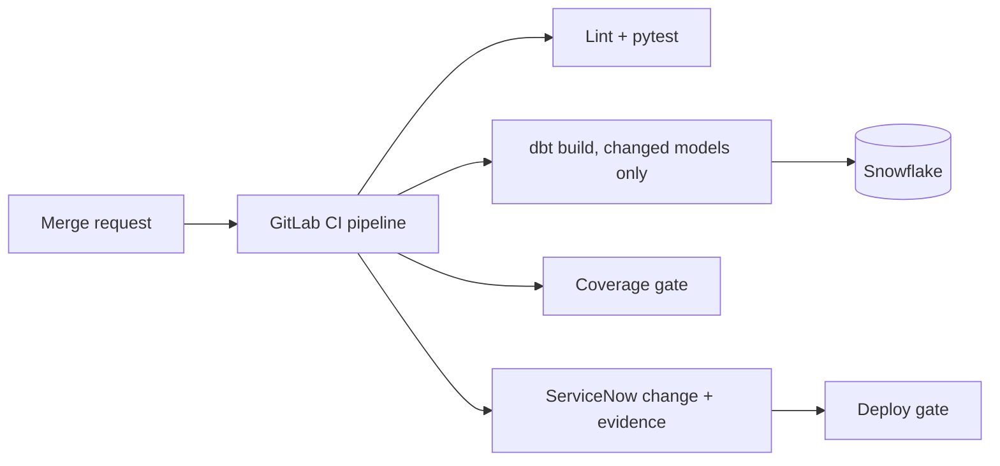

# DQ Gate

A GitLab CI/CD pipeline that runs dbt tests and Snowflake data quality checks, blocks a merge or deploy when testing coverage is missing, and records evidence in a ServiceNow change request.

**Status:** M0-M1 scaffold (repo, tooling, merge-request pipeline with lint and tests). See [docs/PROJECT_PLAN.md](docs/PROJECT_PLAN.md) for the full plan, milestones and timeline.

All data in this project is synthetic.

## Architecture (target)



## Quick start

Requires Python 3.11+.

```bash
make setup     # venv, dev dependencies, pre-commit hooks
make check     # lint + tests (what CI runs)
```

Copy `.env.example` to `.env` for local credentials. Never commit `.env`.

## Repository layout

```
.gitlab-ci.yml        merge-request pipeline
src/dq_tools/         Python tooling (config, ServiceNow client, later: coverage gate, reporting)
tests/                pytest unit tests
dbt/                  dbt project (M3)
scripts/              utilities added in later milestones
docs/                 project plan, AI workflow log
```

## GitLab setup checklist (M1)

1. Create the project and push `main`.
2. Settings > Repository > Protected branches: protect `main`, no direct pushes.
3. Settings > Merge requests: enable **Pipelines must succeed**.
4. Optional: register a self-hosted runner and uncomment `tags:` in `.gitlab-ci.yml`.
5. Open a merge request and confirm `lint` and `unit-tests` run.
6. Break a test on purpose, confirm the merge is blocked, then fix it (screenshot for the README).
