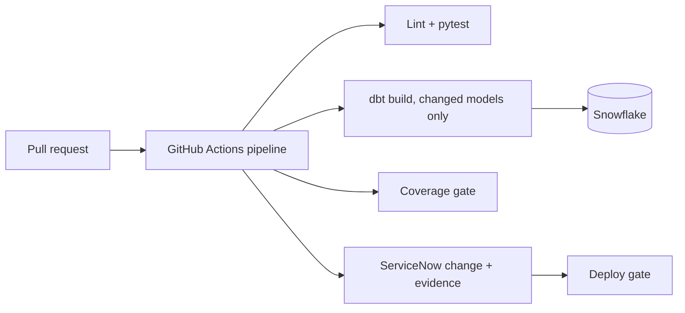
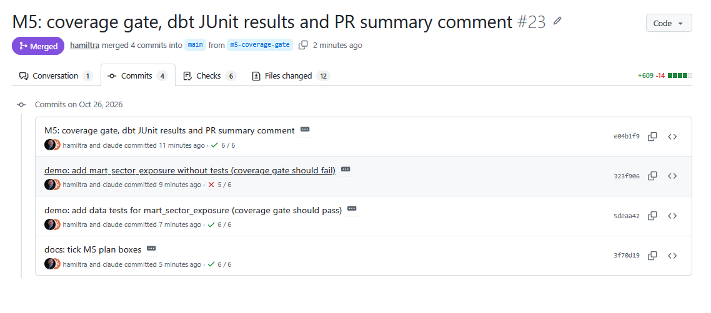
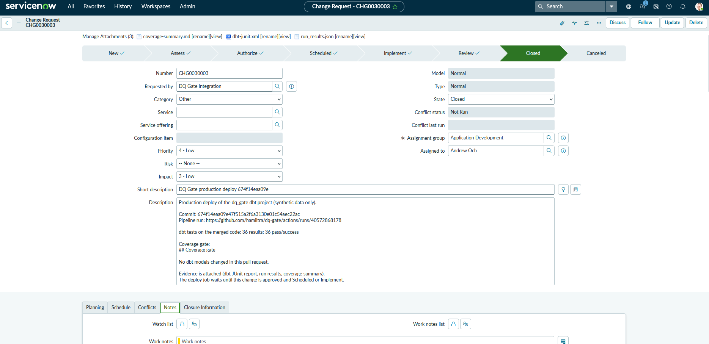
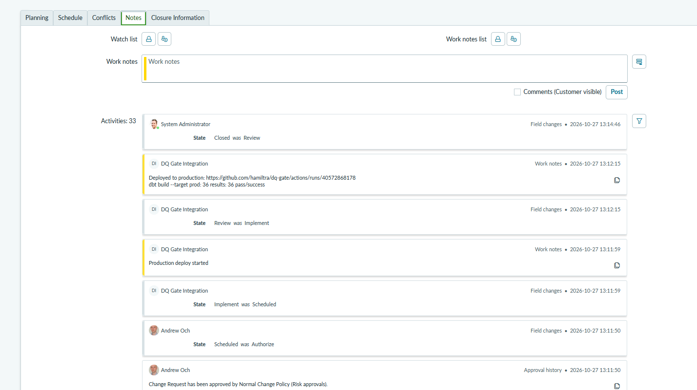
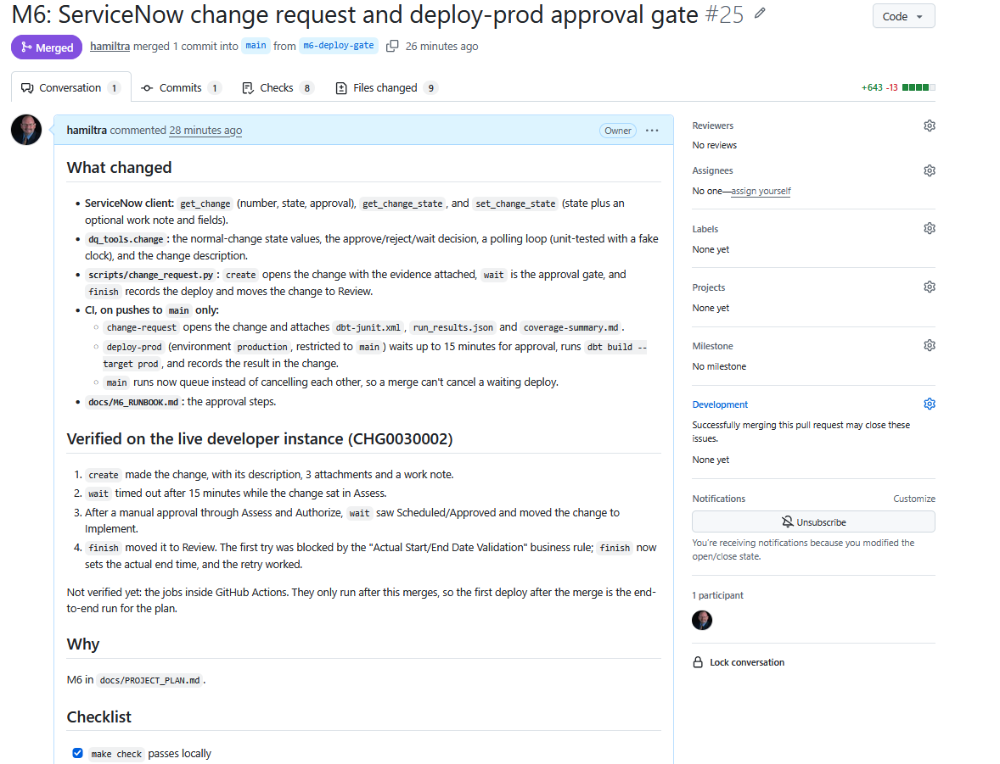

# DQ Gate

A GitHub Actions pipeline that runs dbt tests and Snowflake data quality checks, blocks a merge or deploy when testing coverage is missing, and records evidence in a ServiceNow change request.

**Status:** M6 complete (every pull request is gated by dbt tests, data metric functions and a test coverage gate; every production deploy waits for an approved ServiceNow change). Next: M7, polish and publish. See [docs/PROJECT_PLAN.md](docs/PROJECT_PLAN.md) for the full plan, milestones and timeline.

All data in this project is synthetic.

## Architecture (target)



## Quick start

Requires Python 3.11+.

```bash
make setup     # venv, dev dependencies, pre-commit hooks
make check     # lint + tests (what CI runs)
```

Copy `.env.example` to `.env` for local credentials. Never commit `.env`.

## Repository layout

```
.github/workflows/   CI pipeline (pull requests and main), manual RAW reload, DMF checks
src/dq_tools/         Python tooling (config, ServiceNow client, synthetic data, RAW loader, DMFs)
tests/                pytest unit tests
dbt/                  dbt project: staging and mart models, tests, CI schema macros
snowflake/            one-off Snowflake setup SQL (grants)
scripts/              CLI entry points (data generation, RAW load, DMFs, smoke tests, dbt in Docker)
docs/                 project plan, runbooks, AI workflow log, screenshots
```

## GitHub setup checklist (M1)

1. Push `main` to GitHub (done if you can see the files).
2. Settings > Rules > Rulesets > New branch ruleset, target `main`:
   - Require a pull request before merging
   - Require status checks to pass (add `lint` and `unit-tests` after their first run)
   - Block force pushes
3. Open a pull request and confirm `lint` and `unit-tests` run under Actions.
4. Break a test on purpose, confirm the merge is blocked, then fix it (screenshot for the README).
5. Optional: register a self-hosted runner (Settings > Actions > Runners). Do not let fork pull requests run on it if the repo is public.


## Merge gate demo (M1)

`main` is protected by a branch ruleset: changes need a pull request, and the `lint` and `unit-tests` checks must pass before merging. To prove it, I broke a test on purpose (PR #2).

**Blocked:** `unit-tests` fails, so the merge button is disabled.


**Unblocked:** after reverting the change, both required checks pass and the merge is allowed.


## ServiceNow integration (M2)

`dq_tools.servicenow.ServiceNowClient` creates a change request, adds a work note and attaches a file through the ServiceNow REST API. Unit tests mock all HTTP calls, so CI never touches a live instance. A hand-run smoke test (`python scripts/servicenow_smoke.py`) exercises the real API against a personal developer instance using a dedicated least-privilege integration user.


## M3: dbt pipeline gated in CI

Synthetic securities, daily prices and positions (seeded, no real data) are loaded into
Snowflake `DQ_DEMO.RAW`. A dbt project builds staging views and mart tables with 25 data
tests and 1 unit test. Every pull request runs `dbt build` against its own schemas
(`CI_PR_<n>_STAGING`, `CI_PR_<n>_MARTS`), which are dropped when the job ends. CI logs in
with key-pair auth; the private key lives only in a GitHub secret.

The gate demo: I loaded RAW with three known defects (a duplicate security, a negative price,
and an orphan position). Four tests failed, the marts were skipped, and the merge was blocked.
After reloading clean data, all 32 nodes passed.

| Defects loaded: merge blocked | Failing tests | Clean data: all checks pass |
|---|---|---|
|  |  |  |

| Defect | Test that caught it |
|---|---|
| Duplicate security | `unique_stg_securities_security_id`, `unique_stg_securities_ticker` |
| Negative price | `assert_prices_positive` |
| Orphan position | `relationships_stg_positions_security_id` |

Dependabot PRs skip `dbt-build` because GitHub does not give them Actions secrets.
Slim CI (only changed models) is still to do.

## M4: Snowflake data metric functions

Five checks run against `DQ_DEMO.RAW`: `NULL_COUNT` on `security_id` and `close_price`,
`DUPLICATE_COUNT` on `SECURITIES.security_id`, `FRESHNESS`, and a custom function,
`DQ_AUDIT.NON_POSITIVE_COUNT`, that counts zero or negative prices. The functions are attached to the
tables, so Snowflake evaluates them itself whenever the data changes. `scripts/dmf.py check` also
calls each one directly, compares the value with a limit, writes a row per check to
`DQ_AUDIT.DMF_RESULTS`, and exits non-zero on a failure. The `dmf-check` CI job runs it on every
pull request.

```bash
python scripts/dmf.py apply     # create the custom function and attach the functions (once)
python scripts/dmf.py check     # run the checks, record results, fail on a bad value
python scripts/dmf.py native    # show what Snowflake recorded for the attached functions
```

With the injected defects loaded, the duplicate security and the negative price were caught; the
orphan position is a cross-table problem that only the dbt `relationships` test catches.

| Defects loaded: two checks fail | Clean data: all pass | Results in `DQ_AUDIT` |
|---|---|---|
|  |  |  |

Scheduled DMFs run on Snowflake-managed compute. To pause them, set `DATA_METRIC_SCHEDULE = ''`
on the RAW tables; `scripts/dmf.py apply` turns them back on.

## M5: test coverage gate and reporting

The `coverage-gate` job fails a pull request when a dbt model it changes has no data tests. It
diffs the branch against its base and reads dbt's `manifest.json`, built with `dbt parse`, so it
needs no Snowflake credentials. A model counts as changed when its SQL or its properties YAML
changes, so deleting a model's tests is caught too. A model is covered when a generic test is
attached to it or a singular test refs it. Unit tests are listed but do not count on their own,
because they check the SQL logic, not the data. `coverage-gate` is a required check on `main`.

Every pull request also gets:

- a **dbt results** check: `scripts/results_to_junit.py` turns dbt's `run_results.json` into
  JUnit XML, one test case per model and test, and the pipeline publishes it on the pull request
- a summary comment from the gate, listing each changed model and its test counts, updated on
  every push instead of posted again

```bash
python scripts/coverage_gate.py --base origin/main   # after dbt parse; exit 1 if a model lacks tests
python scripts/results_to_junit.py                   # target/run_results.json -> dbt-junit.xml
```

The gate demo (PR #23): I added a new model, `mart_sector_exposure`, without tests. The gate
failed (5 of 6 checks) and the merge was blocked. The next commit added three data tests and all
6 checks passed.



## M6: ServiceNow change and deploy gate

Every merge to `main` goes to production only through an approved ServiceNow change. After the
checks pass again on the merged code, the `change-request` job opens a normal change and attaches
the evidence: the dbt JUnit report, `run_results.json` and the coverage summary. Its description
names the commit, the pipeline run and the test counts. The `deploy-prod` job (GitHub environment
`production`, which only `main` can deploy to) then checks the change every 30 seconds:

- **Approved and Scheduled:** it moves the change to Implement, runs `dbt build --target prod`,
  adds a work note with the results and moves the change to Review.
- **Rejected or canceled:** it fails at once.
- **No decision in 15 minutes:** it fails with a message to approve the change and re-run the job.
  The re-run picks up the same change.

The pipeline cannot approve its own change. A person approves it in ServiceNow and closes it
after review. Runs on `main` queue instead of cancelling each other, so a new merge never cancels
a deploy that is waiting.

```bash
python scripts/change_request.py create --sha <commit> --run-url <url> --attach dbt-junit.xml
python scripts/change_request.py wait --sys-id <sys_id>       # exit 0 once approved and scheduled
python scripts/change_request.py finish --sys-id <sys_id> --result success --run-url <url>
```

The first end-to-end run (PR #25, change CHG0030003): the first 15-minute wait ran out while the
change was still waiting for CAB approval, so the job failed as designed. After the approval, a
re-run of the job moved the change to Implement, deployed all 36 models and tests to `STAGING`
and `MARTS`, and moved the change to Review. I closed it by hand after the review.
[docs/M6_RUNBOOK.md](docs/M6_RUNBOOK.md) has the approval steps.

| Change opened by the pipeline, with evidence | Activity: approval, deploy, review | The pull request |
|---|---|---|
|  |  |  |
