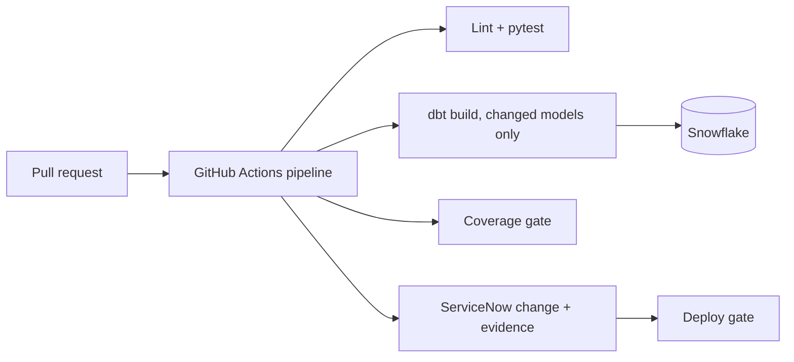
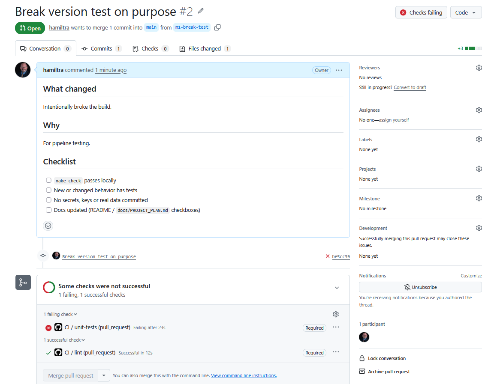
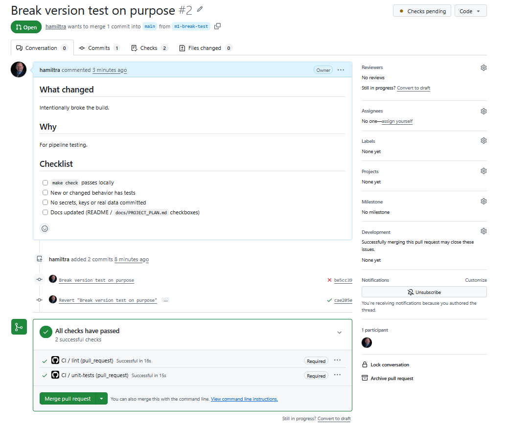
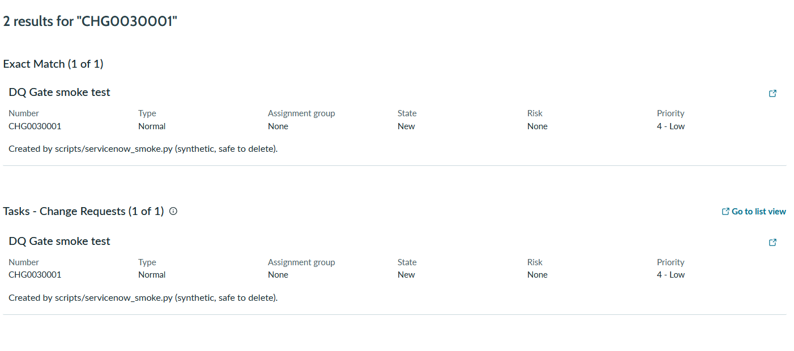

# DQ Gate

A GitHub Actions pipeline that runs dbt tests and Snowflake data quality checks, blocks a merge or deploy when testing coverage is missing, and records evidence in a ServiceNow change request.

**Status:** M2 complete (ServiceNow client with mocked tests and a live smoke test). Next: M3, Snowflake and dbt in CI. See [docs/PROJECT_PLAN.md](docs/PROJECT_PLAN.md) for the full plan, milestones and timeline.

All data in this project is synthetic.

## Architecture (target)



## Quick start

Requires Python 3.11+.

```bash
make setup     # venv, dev dependencies, pre-commit hooks
make check     # lint + tests (what CI runs)
```

Copy `.env.example` to `.env` for local credentials. Never commit `.env`.

## Repository layout

```
.github/workflows/   CI pipeline (pull requests and main)
src/dq_tools/         Python tooling (config, ServiceNow client, later: coverage gate, reporting)
tests/                pytest unit tests
dbt/                  dbt project (M3)
scripts/              utilities added in later milestones
docs/                 project plan, AI workflow log
```

## GitHub setup checklist (M1)

1. Push `main` to GitHub (done if you can see the files).
2. Settings > Rules > Rulesets > New branch ruleset, target `main`:
   - Require a pull request before merging
   - Require status checks to pass (add `lint` and `unit-tests` after their first run)
   - Block force pushes
3. Open a pull request and confirm `lint` and `unit-tests` run under Actions.
4. Break a test on purpose, confirm the merge is blocked, then fix it (screenshot for the README).
5. Optional: register a self-hosted runner (Settings > Actions > Runners). Do not let fork pull requests run on it if the repo is public.


## Merge gate demo (M1)

`main` is protected by a branch ruleset: changes need a pull request, and the `lint` and `unit-tests` checks must pass before merging. To prove it, I broke a test on purpose (PR #2).

**Blocked:** `unit-tests` fails, so the merge button is disabled.



**Unblocked:** after reverting the change, both required checks pass and the merge is allowed.



## ServiceNow integration (M2)

`dq_tools.servicenow.ServiceNowClient` creates a change request, adds a work note and attaches a file through the ServiceNow REST API. Unit tests mock all HTTP calls, so CI never touches a live instance. A hand-run smoke test (`python scripts/servicenow_smoke.py`) exercises the real API against a personal developer instance using a dedicated least-privilege integration user.


