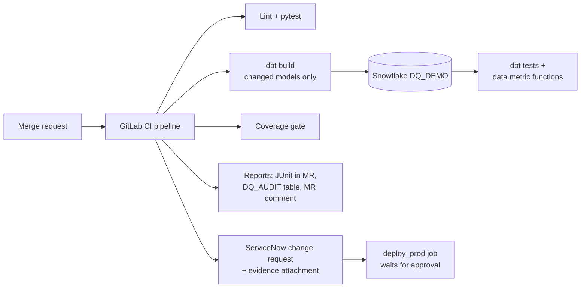

# DQ Gate: Project Plan

A GitLab CI/CD pipeline that runs dbt tests and Snowflake data quality checks, blocks a merge or deploy when testing coverage is missing, and records the evidence in a ServiceNow change request.

- **Estimated effort:** 40-50 hours over 4 weeks (about 10-12 hours per week)
- **Start:** after the Thursday Oct 8 resume/LinkedIn refactor (work window Oct 8 - Nov 8, buffer to Nov 15)
- **Data:** synthetic financial data only (security master, daily prices, positions)
- **Confidentiality:** do not reuse any real data, code or designs from current or former employers

> Free-tier limits change. Check current terms when you sign up for each service.

---

## 1. Architecture

## 2. Accounts

| Account | Purpose | Notes |
|---|---|---|
| GitLab.com (free) | Repo, CI/CD, merge requests | Shared runners may need identity verification. A self-hosted runner on your Docker Swarm avoids it. |
| GitHub | Public portfolio mirror | Mirror the finished repo. |
| Snowflake trial | Warehouse and data metric functions | Choose **Enterprise edition** (DMFs need it). About 30 days, so start at end of Week 1. |
| ServiceNow Developer Program | Personal developer instance (PDI) | Hibernates when idle; log in at least weekly. |
| dbt | dbt Core (free) | The dbt platform developer plan is optional. |
| AI coding tool | Claude Code, GitHub Copilot, Windsurf or similar | Log how you used it in `docs/AI_WORKFLOW.md`. |

## 3. Local software

- Python 3.11+ (venv or `uv`), Git, VS Code
- Python packages: `dbt-core`, `dbt-snowflake`, `snowflake-connector-python`, `pytest`, `pytest-cov`, `requests`, `python-gitlab`, `python-dotenv`, `ruff`, `pre-commit`, `faker`, optionally `sqlfluff`, `fastapi`, `uvicorn`
- dbt packages: `dbt_utils`, `dbt_expectations`, optionally `dbt_project_evaluator`
- Docker (self-hosted GitLab runner, stretch API service), Postman (exploring the ServiceNow API)

## 4. Components to build

1. Repo skeleton: README, `.gitignore`, `.env.example`, pre-commit hooks, Makefile
2. GitLab pipeline with stages: lint, test, dbt build, quality gate, report, deploy (merge-request pipelines)
3. Snowflake setup: XS warehouse with short auto-suspend, resource monitor, `DQ_DEMO` database (`RAW`, `STAGING`, `MARTS`, `DQ_AUDIT`), key-pair service user, least-privilege role
4. dbt project: sources with freshness, staging and mart models, generic and singular tests, unit tests, changed-models-only CI (`state:modified+`, `--defer --state`)
5. Snowflake data metric functions: system DMFs (null count, duplicate count, freshness) plus one custom DMF
6. Coverage gate: Python script reading `manifest.json`; fails if changed models lack tests; protected branches and "pipelines must succeed" make it enforceable
7. Reporting: `run_results.json` to JUnit XML, a row per run in `DQ_AUDIT.TEST_RUNS`, summary comment on the merge request
8. ServiceNow client: create change request, attach evidence, update work notes, read change state
9. Deploy gate: `deploy_prod` job polls the change state and proceeds only when approved
10. Unit tests for the tooling (mocked HTTP), run in the same pipeline
11. Documentation: README, Mermaid diagram, setup guide, `AI_WORKFLOW.md`, screenshots
12. Stretch: FastAPI wrapper (`POST /runs`, `GET /coverage`, `POST /change-requests`) deployed on the homelab; an AI step that summarizes failing tests in a merge request comment

## 5. Timeline and milestones

| Week | Dates | Focus | Milestones |
|---|---|---|---|
| Prep | Oct 8-11 | Accounts, installs, repo | **M0** |
| 1 | Oct 12-18 | GitLab CI basics, ServiceNow API | **M1**, **M2**; start Snowflake trial Oct 17-18 |
| 2 | Oct 19-25 | Snowflake and dbt | **M3**, **M4** |
| 3 | Oct 26-Nov 1 | Gates and integration | **M5**, **M6** |
| 4 | Nov 2-8 | Polish and publish | **M7** |
| Buffer | Nov 9-15 | Slippage, interview practice | Finish before the Snowflake trial ends (~Nov 16) |

### M0: Repo and accounts ready (about 4 hours)
- [ ] GitLab project created (`dq-gate`), default branch `main`
- [ ] ServiceNow developer account and PDI requested and reachable
- [ ] Python 3.11+ installed; `make setup` completes
- [ ] `make check` passes locally (lint and tests)
- [ ] Pre-commit hooks installed (`pre-commit install`)
- [ ] First commit pushed to GitLab

### M1: Merge-request pipeline with a gate (Week 1)
- [ ] Pipeline runs on a merge request with `lint` and `test` jobs
- [ ] Test results and coverage appear in the merge request
- [ ] `main` is protected; direct pushes disallowed
- [ ] Settings: "Pipelines must succeed" enabled for merges
- [ ] Demonstrated: a failing test blocks the merge; a fix unblocks it (screenshot for README)

### M2: ServiceNow API proof (Week 1)
- [ ] Integration user created in the PDI with the roles needed for change management
- [ ] Credentials stored in `.env` locally and in masked GitLab CI/CD variables
- [ ] Script creates a change request, adds a work note, and attaches a file
- [ ] Unit tests with mocked HTTP responses

### M3: Snowflake and dbt in CI (Week 2)
- [ ] Snowflake trial started (Enterprise); warehouse, resource monitor, database, schemas, role, key-pair user
- [ ] Synthetic data generated and loaded
- [ ] dbt project with staging and mart models, generic and singular tests, source freshness
- [ ] CI job runs `dbt build` using key-pair auth
- [ ] Slim CI: only changed models and their dependents run

### M4: Snowflake native checks (Week 2)
- [ ] At least three DMFs attached to tables (for example null count, duplicate count, freshness)
- [ ] One custom DMF
- [ ] Results queryable and written to `DQ_AUDIT`

### M5: Coverage gate and reporting (Week 3)
- [ ] Script fails the pipeline when a changed model has no tests
- [ ] Passing after a test is added (demonstrate both in screenshots)
- [ ] JUnit XML results visible in the merge request
- [ ] Merge request comment with a summary posted by the pipeline

### M6: ServiceNow integration and deploy gate (Week 3)
- [ ] Pipeline creates a change request and attaches the test report
- [ ] `deploy_prod` waits for approved state
- [ ] End-to-end run recorded

### M7: Polish and publish (Week 4)
- [ ] README with diagram, setup steps and screenshots
- [ ] `AI_WORKFLOW.md` completed
- [ ] 2-3 minute demo recording
- [ ] Repo mirrored to GitHub (no secrets in history)
- [ ] Resume and LinkedIn updated with accurate bullets

## 6. Definition of done

- Public repo with a clean README, working pipeline and a demo
- A merge request that fails for missing tests, then passes once tests are added
- A ServiceNow change record with evidence attached by the pipeline
- Resume and LinkedIn describe the project accurately

## 7. Risks and tips

| Risk | Mitigation |
|---|---|
| Snowflake trial expires | Do not start it until Week 1 ends; a resource monitor caps spend |
| ServiceNow PDI hibernates or is reclaimed | Log in weekly; keep scripts rebuildable |
| Secrets leaked | Masked and protected GitLab variables; `.env` in `.gitignore`; scan history before mirroring |
| Scope creep | FastAPI and AI step are optional; the coverage gate and ServiceNow integration are the JD-relevant core |
| Employer confidentiality | Synthetic data and original designs only |

## 8. Interview talking points (fill in as you build)

- What the coverage gate checks and why
- How you authenticate to Snowflake and ServiceNow from CI
- What data metric functions did that dbt tests could not (and the reverse)
- How you used AI tools, what you reviewed by hand, and where you stopped trusting output
